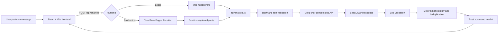

# RedFlag — Internship Scam Detector

**Spot the red flags before you apply.**

RedFlag helps students assess internship offers, recruitment messages,
scholarship messages, and forwarded opportunities for potential scam
indicators. It returns an AI-assisted risk assessment with evidence-oriented
findings and practical next steps.

RedFlag is not a fraud verification service. Its results can be incomplete or
wrong and are not definitive proof that an employer, link, or opportunity is
fraudulent. Independently verify opportunities before responding, paying, or
sharing information.

## Features

- Analyze pasted internship, recruitment, scholarship, or forwarded messages.
- Identify potential warning signs with quoted or distinctive evidence where
  the model provides it.
- Classify findings as `severe`, `high`, `medium`, or `low`.
- Calculate a backend-owned trust score and verdict from validated findings.
- Apply a deterministic severe policy when a message explicitly requires
  payment before an offer is received.
- Validate AI output with Zod and strict structured-output requirements.
- Reject malformed JSON, invalid input, oversized request bodies, and
  unavailable provider responses with safe API errors.
- Handle provider rate-limit responses with a sanitized HTTP 429 response and
  retry timing.
- Provide English and Hindi interface translations.
- Offer a report view, clause/finding details, and an action-plan view.
- Include an offline mocked API test suite and a separate manually invoked
  live-AI evaluation harness using synthetic fixtures.

RedFlag does not currently provide file uploads, URL scanning, browser
extensions, authentication, user accounts, saved reports, or persistent
history.

## Demo and screenshots

- **Live demo:** https://redflag-cem.pages.dev/
- **Screenshots:** Add product screenshots here after a stable deployment is
  available.

## Technology stack

- **React 18** and **React Router** — user interface and client-side routes.
- **Vite 5** — development server and frontend build.
- **TypeScript** — frontend, API, and configuration code.
- **Tailwind CSS** — styling utilities and design tokens.
- **Zod** — request and provider-response validation.
- **Groq OpenAI-compatible API** — AI analysis provider.
- **Node built-in test runner** — offline API tests.

The package is private and is not published as an npm package.

## Architecture

During local development, Vite middleware exposes the analysis handler at the
same-origin `/api/analyze` route. In production, Cloudflare Pages Functions
routes the same endpoint through `functions/api/analyze.ts`, which passes the
server-side `GROQ_API_KEY` binding to the shared backend handler in
`api/analyze.ts`. Unknown `/api/*` paths are handled by
`functions/api/[[path]].ts` and return an API-style 404 response.



### Analysis flow

1. The frontend submits `{ "text": "..." }` to `POST /api/analyze`.
2. The handler accepts only `POST`, reads a bounded JSON body, and validates
   trimmed text between 20 and 8,000 characters.
3. The handler sends the text to Groq using model
   `openai/gpt-oss-20b`, temperature `0.2`, and strict JSON-schema output.
4. The provider response is parsed and validated with the same required
   finding, explanation, `whyItMatters`, and `whatToDo` constraints.
5. Exact normalized duplicate findings count once, retaining the strongest
   severity.
6. A deterministic policy promotes an explicit payment requirement tied to
   receiving an offer to one severe finding. Ordinary fee mentions, waived
   fees, contextual mentions, and payment after an offer do not trigger that
   policy.
7. The backend calculates `trustScore` and `verdict`; model-supplied score or
   verdict fields do not control the response.
8. The frontend displays the result and provides follow-up safety actions.

The API has a 64 KiB (65,536-byte) request-body limit and a 20-second timeout
for the upstream Groq request. Production does not retry Groq requests
automatically. Provider HTTP 429 responses are returned as sanitized 429
responses with bounded retry timing.

## Project structure

```text
.
├── api/
│   └── analyze.ts              # Edge-compatible analysis handler
├── functions/
│   └── api/
│       ├── analyze.ts          # Cloudflare Pages production adapter
│       └── [[path]].ts         # Unknown API-route fallback
├── scripts/
│   └── evaluate-analysis.ts   # Manually invoked live-AI evaluator
├── src/
│   ├── components/            # Shared UI and accessibility components
│   ├── context/               # Analysis state
│   ├── lib/
│   │   └── i18n.ts            # English and Hindi translations
│   ├── screens/               # Landing, processing, report, and plan views
│   ├── App.tsx                # Browser routes
│   └── data.ts                # Shared frontend types and sample content
├── tests/
│   ├── analysis-fixtures.ts   # Synthetic evaluation fixtures
│   └── api-analyze.test.ts    # Offline API and scoring tests
├── index.html                 # Browser metadata and app entry point
├── vite.config.ts             # Vite and local API middleware
├── package.json               # Scripts and dependencies
├── package-lock.json          # npm dependency lockfile
└── .gitignore                 # Local secrets and generated files
```

Generated directories, local environment files, and evaluation reports are
intentionally excluded from this tree.

## Prerequisites and local setup

Prerequisites:

- Node.js with support for the repository's TypeScript and Vite toolchain.
- npm, using the committed `package-lock.json`.
- A Groq API key for local interactive analysis.

Clone the repository using the verified Git remote:

```bash
git clone https://github.com/bh462007/RedFlag.git
cd RedFlag
```

Install dependencies:

```bash
npm ci
```

Create `.env.local` in the project root. Keep the value server-side and do not
use a `VITE_` prefix:

```text
GROQ_API_KEY=<your-groq-api-key>
```

Start the local development server:

```bash
npm run dev
```

Open the local Vite URL printed in the terminal. The custom Vite middleware
routes local `POST /api/analyze` requests to the shared API handler. Production
requests use the Cloudflare Pages Function described below.

## API reference

### `POST /api/analyze`

Request content type:

```text
Content-Type: application/json
```

Request body:

```json
{
  "text": "Please send the internship offer message here for analysis."
}
```

`text` is required, must be a string between 20 and 8,000 characters after
trimming, and must be contained in a request body no larger than 65,536 bytes.
There are no optional request fields.

Successful responses contain the validated analysis plus backend-generated
score fields:

```json
{
  "redFlags": [
    {
      "text": "pay a mandatory training fee before receiving your offer letter",
      "severity": "severe",
      "explanation": "This message explicitly requires payment before the offer is received."
    }
  ],
  "whyItMatters": "Payment required before an offer should be independently verified.",
  "whatToDo": [
    "Verify the opportunity through an official channel.",
    "Do not pay before you have independently verified the offer.",
    "Do not share passwords, OTPs, or banking details."
  ],
  "trustScore": 65,
  "verdict": "suspicious"
}
```

Response fields:

| Field | Type | Description |
| --- | --- | --- |
| `redFlags` | array | Up to six validated findings. |
| `redFlags[].text` | string | Evidence phrase or finding text, up to 120 characters. |
| `redFlags[].severity` | string | `severe`, `high`, `medium`, or `low`. |
| `redFlags[].explanation` | string | Explanation of the finding. |
| `whyItMatters` | string | Overall relevance of the findings. |
| `whatToDo` | string array | Three to six practical safety steps. |
| `trustScore` | number | Backend-calculated score from 0 to 100. |
| `verdict` | string | `safe`, `suspicious`, or `scam`. |

Possible errors:

| Status | Response | Meaning |
| --- | --- | --- |
| `400` | `{ "error": "Invalid JSON body" }` | The request body is not valid JSON. |
| `400` | `{ "error": "Text is required and must be between 20 and 8000 characters" }` | The request shape or text length is invalid. |
| `405` | `{ "error": "Method not allowed" }` | The endpoint requires `POST`. |
| `413` | `{ "error": "Request body too large" }` | The body exceeds 65,536 bytes. |
| `429` | Busy-service error with `retryAfterSeconds` | Groq or an upstream service is rate-limited. |
| `500` | `{ "error": "Server misconfigured: GROQ_API_KEY missing" }` | The server-side provider key is not configured. |
| `502` | Generic AI-service or analysis error | Groq failed or returned invalid analysis output. |
| `504` | Timeout error | The upstream analysis request exceeded 20 seconds. |

Provider error details and submitted message content are not returned to the
client.

## Risk scoring and safety

The score is a deterministic heuristic, not a calibrated probability of
fraud:

```text
trustScore = clamp(100 - sum(unique finding weights), 0, 100)
```

| Severity | Weight |
| --- | ---: |
| `severe` | 35 |
| `high` | 20 |
| `medium` | 10 |
| `low` | 5 |

Verdicts use these unchanged score thresholds:

- `70–100`: `safe`
- `40–69`: `suspicious`
- `0–39`: `scam`

Exact normalized duplicate finding text is counted once, using the strongest
severity. A severe finding therefore produces a score of 65 and a
`suspicious` verdict under the current heuristic.

AI-generated findings can vary and can be wrong. RedFlag does not verify
employers, links, payment requests, or identities externally. Independently
verify the sender and opportunity, never share passwords, OTPs, bank/card
details, or government ID information, and do not pay a fee solely because an
analysis recommends or displays a particular result.

## Testing and quality checks

Run the offline automated test suite:

```bash
npm test
```

This uses Node's built-in test runner and mocked provider responses. It covers
request validation, body-size handling, provider failures and 429 behavior,
structured-output validation, deterministic scoring, duplicate handling,
payment-before-offer policy cases, and fixture-based backend evaluation. It
does not call Groq.

Run the frontend and API typechecks:

```bash
npm run typecheck
npm run typecheck:api
```

Run linting and the production build:

```bash
npm run lint
npm run build
```

The separate live-AI evaluator is manually invoked and is not part of
`npm test`:

```bash
npm run evaluate:analysis
npm run evaluate:analysis -- 3
npm run evaluate:analysis -- --retry-failed
```

It loads `.env.local`, sends only the synthetic fixtures from
`tests/analysis-fixtures.ts`, validates provider responses, calculates scores
with backend functions, and writes local reports under
`reports/analysis-evaluation/`. It can make real Groq requests, so run it only
when live evaluation is intended.

## Deployment

RedFlag is deployed at
[https://redflag-cem.pages.dev/](https://redflag-cem.pages.dev/) using Cloudflare
Pages with Pages Functions.

The production setup is:

- Build command: `npm run build`
- Static output directory: `dist`
- Same-origin analysis endpoint: `POST /api/analyze`
- Pages Function adapter: `functions/api/analyze.ts`
- Shared backend handler: `api/analyze.ts`
- Unknown API-route fallback: `functions/api/[[path]].ts`
- Server-side secret: `GROQ_API_KEY`, configured in Cloudflare Pages

`GROQ_API_KEY` must remain a server-side Cloudflare secret. Do not expose it
through frontend code, a `VITE_` variable, or committed configuration.

The Vite middleware in `vite.config.ts` is for local development only. Cloudflare
Pages Functions handle the production API route, while Pages serves the built
SPA assets and client-side routes.

After a deployment, verify the live homepage, direct navigation to the
client-side routes, `POST /api/analyze`, and an unknown `/api/*` route. Confirm
that invalid API requests return sanitized JSON errors rather than the SPA
HTML.

## Limitations and roadmap

### Current limitations

- Results are AI-assisted and may be incomplete, inconsistent, or incorrect.
- Exact evidence matching and fixture comparisons in the live evaluator are
  heuristics, not proof of semantic grounding.
- There is no authentication, account system, saved report history, or
  persistent storage.
- There is no file upload, URL scanning, browser extension, or external
  employer verification.
- Platform-level usage controls such as application-specific rate limiting are
  not currently implemented.
- The package has no committed application license.

### Possible future work

- Add additional production smoke tests and operational checks for the
  Cloudflare Pages deployment.
- Add platform-appropriate rate limiting and provider-usage protection.
- Improve evaluation of unsupported claims and semantic evidence grounding.
- Add privacy-reviewed observability and deployment smoke tests.
- Add broader accessibility and end-to-end browser coverage.

These are plans, not currently implemented features.

## Contributing

1. Create a focused branch for your change.
2. Keep API response fields, validation, and safety behavior backward
   compatible unless the change explicitly requires otherwise.
3. Do not add real personal messages, credentials, API keys, or provider
   responses to the repository.
4. Add or update offline tests for behavior changes.
5. Run the tests, typechecks, lint, build, and `git diff --check` before
   opening a pull request.

No `LICENSE` or `LICENCE` file is present, so no open-source license has been
specified yet.
